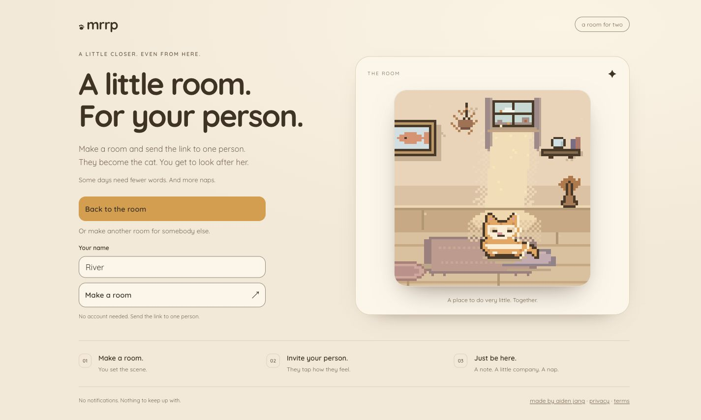

# mrrp

A tiny room for two. One of you is the cat.

[Open mrrp](https://mrrp.aidenjang.com) · [Architecture](ARCHITECTURE.md) · [Contributing](CONTRIBUTING.md)



Make a room, send someone the link, and look after their very small alter ego. You name her,
choose her look and leave notes. They get to be the cat: answer back, draw something for the
wall, sit in a box. A fairly good arrangement.

The room changes with her local time and weather. It remembers little things you do together.
There are no streaks, overdue visits or consequences for having a life.

## Run locally

Use Node 22 or newer and pnpm 9.15. Install dependencies, then start the Worker and web app in
separate terminals:

```sh
pnpm install --frozen-lockfile
pnpm run dev:worker
pnpm run dev:web
```

Open <http://localhost:30005>. The local API runs on port 8787. Wrangler keeps local room state
in its own development storage; it does not use production rooms.

## Check a change

```sh
pnpm run verify
```

This runs the repository gates, types, lint, formatting, build, unit tests and browser journeys.
Worker tests use real Durable Objects. Canvas tests use a recording context and a controlled
frame clock. See [contributing](CONTRIBUTING.md) for browser setup and review expectations.

## Deploy

A push to `main` runs CI and deploys to Cloudflare after the checks pass. The repository needs
a Workers-scoped `CLOUDFLARE_API_TOKEN` secret. For an authenticated local deployment:

```sh
pnpm run deploy
```

One Worker serves both the app and API. Its deploy command builds the web app first; Durable
Object migrations live in `packages/worker/wrangler.toml`.

## Room links and recovery

A room link can be forwarded, so share it with the person you mean to invite. The Worker enforces
which seat may perform each action. Save the recovery code if you want to return from another
browser; linking an account is optional. Room settings include recovery and deletion controls.

[Privacy](https://accounts.aidenjang.com/privacy) · [Terms](https://accounts.aidenjang.com/terms) ·
[Help or feedback](mailto:me@aidenjang.com). Please keep personal room links and recovery codes
out of public issues.

`packages/shared` owns the common browser/Worker types, choices, and limits. It has no
runtime dependencies; both apps consume the same source contract.

## Repository guide

- [Architecture](ARCHITECTURE.md): runtime boundaries and module ownership.
- [Contributing](CONTRIBUTING.md): development, verification and commits.
- [Engineering conventions](CONVENTIONS.md): constraints enforced during changes.
- [Decisions](DECISIONS.md): current product and engineering choices.
- [Art direction](ART.md): pixel rules and approved references.
- [UI review](docs/ui-review/README.md): reviewed states and remaining verification limits.
- [Security](SECURITY.md): private vulnerability reports.

MIT licensed. See [LICENSE](LICENSE).

The install preview uses the current demonstration-room captures from
[the UI review](docs/ui-review/). Its images live in `packages/web/public/screenshots/`
and are declared with their actual desktop and phone sizes in the web manifest.
Only disposable local room data belongs in these public assets.

Aggregate traffic and feature-event coverage, privacy boundaries and queries: [Analytics](docs/ANALYTICS.md).
